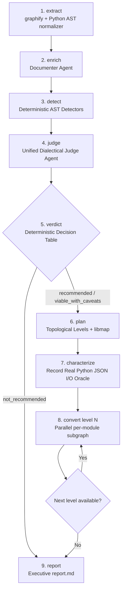
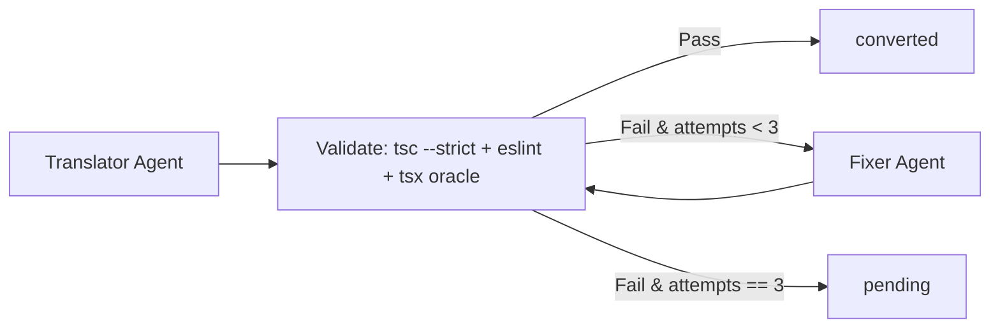

# StackConverter

> **AI-Assisted Source Code Migration Accelerator with a Deterministic Codebase Graph, Pluggable Target Stack Catalog, and Architectural Viability Gate.**

StackConverter translates source code across programming ecosystems (PoC active stack: **Python $\rightarrow$ TypeScript / Node.js (`typescript-node`)**) by combining **deterministic structural analysis** (`graphify` + Python's native `ast`) with **schema-validated LLM agents** orchestrated via **LangGraph**.

Unlike blind "magic" code translators, **StackConverter knows when to say NO**: before generating a single line of target code, its **Viability Gate** audits the source codebase across **7 architectural axes**, cites exact `file:line` source snippets, evaluates whether each risk is `central` or `peripheral` through a **Unified Dialectical Judge Agent**, and halts incompatible migrations (such as CPU-bound `multiprocessing` pools or unmapped C/Fortran scientific libraries like `numpy`/`pandas`) while recommending better-suited target architectures (e.g., Go or Rust).

---

## Table of Contents

1. [Core Architecture & Non-Negotiable Principles](#1-core-architecture--non-negotiable-principles)
2. [Prerequisites & Environment Setup](#2-prerequisites--environment-setup)
3. [Quickstart: Clone, Install & Configure](#3-quickstart-clone-install--configure)
4. [Target Output Stack Selection & Extensibility](#4-target-output-stack-selection--extensibility)
5. [How to Perform a Codebase Migration (Step-by-Step)](#5-how-to-perform-a-codebase-migration-step-by-step)
6. [Deep Dive: Using Every Feature & Resource in the PoC](#6-deep-dive-using-every-feature--resource-in-the-poc)
7. [Output Artifacts Reference (`runs/<run_id>/`)](#7-output-artifacts-reference-runsrun_id)
8. [Caveats, Limitations & Important Observations](#8-caveats-limitations--important-observations)
9. [Repository Structure](#9-repository-structure)
10. [Testing, Linting & Contributing](#10-testing-linting--contributing)
11. [License](#11-license)

---

## 1. Core Architecture & Non-Negotiable Principles

1. **Deterministic Structure Only:** The codebase graph (`graph.json`) is extracted deterministically via `graphify` and Python's native `ast` module. LLM agents enrich node semantics and translate code, but **never** invent or alter the graph structure or dependencies.
2. **Pluggable Target Stack Catalog:** Target stacks are registered in a declarative catalog (`TARGET_STACK_REGISTRY`) that binds each target (`typescript-node`, and roadmap targets like `go` and `rust`) to its own translation rules (`rules/<target>.md`), library equivalence map (`libmap/python_to_<target>.yaml`), and deterministic validator toolchain.
3. **Viability Gate Before Translation:** Five deterministic AST detectors locate risk patterns (`file:line`), a **Unified Dialectical Judge Agent** weighs mitigation vs. incompatibility arguments to classify each finding as `central` or `peripheral`, and a deterministic decision table (`verdict_rules.py`) emits `recommended`, `viable_with_caveats`, or `not_recommended`.
4. **Topological Level-by-Level Conversion:** Internal modules are sorted from leaf dependencies (`Level 0`) up to entry points (`Level N`) via Kahn's algorithm with Strongly Connected Component (SCC) cycle grouping. When converting level $k$, the exact exported TypeScript signatures of already-converted dependencies from levels $< k$ are injected into the prompt.
5. **Generator $\neq$ Validator:** The `Translator Agent` never validates its own output. Deterministic tools (`tsc --noEmit --strict`, `eslint`, and a `tsx` runner executing real JSON input/output **Characterization Oracles** recorded from Python) validate every module and feed exact compiler/runtime diagnostics to the `Fixer Agent` (up to 3 self-healing attempts).
6. **Disk Artifacts & SHA-256 Cache:** Every pipeline stage writes human- and machine-readable JSON/Markdown artifacts to `runs/<run_id>/`, and every LLM call is cached on disk by a canonical SHA-256 key (`cache/` and `demo_cache/`), ensuring instant, zero-cost, offline reproducibility.

### End-to-End Pipeline (`LangGraph`)



### Per-Module Self-Healing Conversion Subgraph



---

## 2. Prerequisites & Environment Setup

- **[uv](https://docs.astral.sh/uv/)** — Manages Python installation, virtual environments (`.venv`), lockfiles (`uv.lock`), and command execution.
- **Python 3.13+** — Provisioned automatically via `uv python install`.
- **Node.js 20+** and **npm** — Required for target TypeScript validation (`tsc`, `eslint`, `tsx`).
- **Git**

### Step 1: Install `uv` and Provision Python

```bash
# macOS / Linux
curl -LsSf https://astral.sh/uv/install.sh | sh

# Ensure ~/.local/bin is in your PATH
export PATH="$HOME/.local/bin:$PATH"

# Install the latest stable Python version via uv
uv python install
```

### Step 2: Install Node.js & Target Validation Toolchain (`tsc`, `eslint`, `tsx`)

If you already have Node.js 20+ installed:
```bash
npm install -g typescript eslint tsx @types/node
```

> **Tip (No System Node.js Installed?):** You can provision an isolated Node.js 22 LTS environment inside `~/.local/node` using `uvx nodeenv` without needing `brew` or root permissions:
> ```bash
> uvx nodeenv --node=22.14.0 "$HOME/.local/node"
> export PATH="$HOME/.local/node/bin:$PATH"
> npm install -g typescript eslint tsx @types/node
> ```
> StackConverter automatically inspects `$HOME/.local/node/bin`, `$HOME/.local/bin`, `/opt/homebrew/bin`, and `/usr/local/bin` when invoking `tsc`, `eslint`, and `tsx`.

---

## 3. Quickstart: Clone, Install & Configure

### 1. Clone the Repository
```bash
git clone git@github.com:doug-cpp/stack-converter.git
cd stack-converter/code
```

### 2. Sync the Python Virtual Environment
```bash
uv sync --all-extras
```
This creates `.venv/` and installs all runtime and development dependencies (`langgraph`, `langgraph-checkpoint-sqlite`, `pydantic`, `langchain-google-genai`, `networkx`, `typer`, `rich`, `pytest`, `ruff`).

### 3. Configure `.env` and `config.yaml`
```bash
cp .env.example .env
cp config.example.yaml config.yaml
```

StackConverter supports three LLM provider modes out of the box (configurable globally via `default_provider` or per agent role via `role_providers` in `config.yaml`):

| Provider Mode | Config Value | When to Use | Requirements |
|---|---|---|---|
| **Fake Deterministic Provider** | `fake` | Local development, CI/CD, unit tests, and offline smoke runs with **zero API cost**. Includes a built-in Python-AST-to-TypeScript transpiler. | None (works out of the box). |
| **Google Gemini API** | `gemini_api` | Cloud LLM execution via `langchain-google-genai` (`gemini-2.5-pro`). | Set `GOOGLE_API_KEY="your-key"` in `.env`. |
| **Claude Code Subscription** | `claude_subscription` | Uses your active Claude Pro/Max subscription session (`claude login`). | Active `claude` session; **`ANTHROPIC_API_KEY` must NOT be set**. |

---

## 4. Target Output Stack Selection & Extensibility

Although this PoC focuses on **Python $\rightarrow$ TypeScript / Node.js**, StackConverter is architected around an extensible **Target Stack Catalog** (`TARGET_STACK_REGISTRY` in `stackconverter/schemas.py`) rather than hardcoded target strings.

### 1. Inspect Available & Roadmap Target Stacks (`targets`)

Run the `targets` command to inspect the registered migration stacks, their aliases, rules/libmap bindings, and deterministic validators:

```bash
uv run stackconverter targets
```

| Stack ID | Aliases | Source $\rightarrow$ Target | Deterministic Validators | Status |
|---|---|---|---|---|
| **`typescript-node`** | `typescript`, `ts`, `node`, `nodejs`, `ts-node` | `python` $\rightarrow$ TypeScript / Node.js (ES2022, strict) | `tsc --noEmit --strict`, `eslint`, `tsx characterization oracle` | **AVAILABLE (PoC)** |
| `go` | `golang` | `python` $\rightarrow$ Go (Golang 1.23+) | `go build`, `go vet`, `go test oracle` | ROADMAP |
| `rust` | `rs` | `python` $\rightarrow$ Rust (Edition 2024) | `cargo check`, `cargo clippy`, `cargo test oracle` | ROADMAP |

### 2. How to Select the Target Output Stack

You can specify the target output stack in **four ways**:

1. **Interactive Terminal Prompt (Default in live TTY):**
   If you run `stackconverter run <source_dir>` or `stackconverter analyze <source_dir>` in an interactive terminal without passing `--target`, StackConverter displays the Target Output Stack Catalog and prompts:
   ```text
   Select the target output stack [typescript-node]:
   ```
   Press `Enter` to accept `typescript-node` or type any supported alias (`typescript`, `ts`, `node`).

2. **CLI Flag (`--target` or `-t`):**
   Pass `--target` (or `-t`) explicitly on any CLI command to skip the interactive prompt:
   ```bash
   uv run stackconverter run fixtures/success_case --target typescript-node --run-id demo_success
   # Or using an alias:
   uv run stackconverter run fixtures/success_case -t typescript --run-id demo_success
   ```

3. **Configuration File (`config.yaml`):**
   Set `default_target_stack: typescript-node` in `config.yaml`.

4. **Environment Variable:**
   Set `STACKCONVERTER_TARGET_STACK="typescript-node"` (and optionally `STACKCONVERTER_NON_INTERACTIVE=1` for CI scripts).

> **Note on Roadmap Targets:** If you pass `--target go` or `--target rust`, StackConverter validates the selection against `TARGET_STACK_REGISTRY` and exits with a clear diagnostic explaining that the stack is registered as `roadmap` in the extensible catalog, while `typescript-node` is the active PoC implementation.

---

## 5. How to Perform a Codebase Migration (Step-by-Step)

All commands are executed from the `code/` directory via `uv run stackconverter`.

### Option A: End-to-End Execution (`run`)

The `run` command executes all 9 stages of the LangGraph pipeline (or halts safely at Stage 5 if the Viability Gate returns `not_recommended`).

#### 1. Migrate the Success Fixture (`fixtures/success_case`)
```bash
uv run stackconverter run fixtures/success_case --target typescript-node --run-id demo_success
```
**What happens under the hood:**
1. **`extract`**: Extracts the codebase graph (`raw_graph.json`) and normalizes AST signatures, parameters, return types, docstrings, and imports (`graph.json`) across all 5 modules (`discounts`, `tax_rules`, `invoice`, `pricing`, `analytics`).
2. **`enrich`**: Runs the `Documenter Agent` on each module (`docs/*.json` and `docs/*.md`) and deterministically strips any cited dependency that does not exist in the AST.
3. **`detect`**: Runs all 5 deterministic AST detectors (`evidences.json`).
4. **`judge`**: Invokes the `Unified Dialectical Judge Agent` (`judgment.json`).
5. **`verdict`**: Evaluates the 7-axis decision table (`verdict.json`) $\rightarrow$ emits **`RECOMMENDED`**.
6. **`plan`**: Sorts modules into 3 topological levels (`Level 0`: `discounts`, `tax_rules` $\rightarrow$ `Level 1`: `invoice`, `pricing` $\rightarrow$ `Level 2`: `analytics`) and resolves library mappings (`plan.json`, `plan.md`).
7. **`characterize`**: Proposes JSON test inputs via the `Characterizer Agent`, imports the real Python modules, and records actual Python return values as the ground-truth oracle (`characterization/*.json`).
8. **`convert_level`**: Translates each module level-by-level into `runs/demo_success/output_ts/src/*.ts`, injecting already-converted neighbor TypeScript signatures, and validates every module with `tsc --noEmit --strict`, `eslint`, and the `tsx` characterization oracle (`validation/*.json`).
9. **`report`**: Generates `runs/demo_success/report.md` and prints Rich summary tables in the terminal.

#### 2. Audit the Refusal Fixture (`fixtures/refusal_case`)
```bash
uv run stackconverter run fixtures/refusal_case --target typescript-node --run-id demo_refusal
```
**What happens under the hood:**
- Detects `multiprocessing`, `ProcessPoolExecutor`, and `SharedMemory` in `parallel_worker.py`, `numpy`, `pandas`, and `ctypes` in `matrix_engine.py`, and dynamic `eval()` in `pipeline.py`.
- The `Unified Dialectical Judge Agent` classifies these high-risk findings as **`central`** to the core architecture.
- The Viability Gate emits **`NOT_RECOMMENDED`**, **halts the pipeline before code generation**, cites exact `file:line` evidences, recommends alternative target stacks (**Go**, **Rust**, or a hybrid Python worker service), and writes `runs/demo_refusal/report.md`.

#### 3. Migrate Your Own Python Project
Point StackConverter to any local Python package or directory:
```bash
uv run stackconverter run /path/to/your/python_project \
  --target typescript-node \
  --provider gemini_api \
  --run-id my_project_migration
```

---

### Option B: Granular Stage-by-Stage Execution (`analyze` $\rightarrow$ `plan` $\rightarrow$ `convert` $\rightarrow$ `validate`)

When auditing a large codebase or iterating on translation rules, you can run each macro-stage independently using a shared `--run-id`:

```bash
# Stage 1 (Steps 1–5): Extract graph, enrich docs, run AST detectors, and compute Viability Verdict
uv run stackconverter analyze fixtures/success_case --target typescript-node --run-id staged_run

# Stage 2 (Step 6): Compute topological conversion levels and library equivalence map
uv run stackconverter plan --target typescript-node --run-id staged_run

# Stage 3 (Steps 7–8): Record Python characterization oracle and translate modules level-by-level
uv run stackconverter convert --target typescript-node --run-id staged_run

# Stage 4 (Steps 8–9): Re-run tsc/eslint/tsx validation on output_ts/ and regenerate report.md
uv run stackconverter validate --target typescript-node --run-id staged_run
```

---

### Inspecting & Running the Generated TypeScript Project

After a successful conversion, `runs/<run_id>/output_ts/` contains a standalone, strict TypeScript project:

```bash
cd runs/demo_success/output_ts

# Run strict TypeScript typechecking directly
tsc --noEmit --strict -p tsconfig.json

# Execute any migrated module with tsx
tsx -e 'import { compute_final_price } from "./src/pricing"; console.log(compute_final_price(100, "gold", "SAVE10", "US_CA"));'
```

---

## 6. Deep Dive: Using Every Feature & Resource in the PoC

### 6.1. Structural Extraction & Normalization (`stackconverter/extract/`)
- **`graphify_runner.py`**: Invokes the `graphify` binary if present in `PATH`, and automatically falls back to a complete, deterministic stdlib `ast` extractor so extraction never fails offline.
- **`normalizer.py`**: Enriches every module, class, and function node with exact `line_start`, `line_end`, `signature`, typed `ParameterInfo` list, `return_annotation`, `docstring`, `source_code`, and deduplicated `imports`.
- **Automatic Test/Env Filtering**: Automatically ignores `.venv`, `__pycache__`, `node_modules`, `tests/`, and `test_*.py` files so only production source modules are scheduled for migration.

### 6.2. Semantic Enrichment & Import Hallucination Guard (`stackconverter/enrich/documenter.py`)
- The `Documenter Agent` generates a structured `NodeDoc` (`purpose`, `inputs`, `outputs`, `side_effects`, `invariants`, `edge_cases`, `external_dependencies`, `error_model`, `concurrency_model`) for each module.
- **Deterministic Post-Check (`_sanitize_cited_dependencies`)**: Before saving `docs/<node_id>.json`, StackConverter cross-checks `doc.external_dependencies` against the actual AST `node.imports` and `CodeGraph` nodes, stripping any hallucinated package name.

### 6.3. The 7-Axis Viability Gate (`stackconverter/viability/`)

#### The 7 Evaluation Axes
1. `concurrency` — Multi-core `multiprocessing`, `ProcessPoolExecutor`, `SharedMemory`, OS threads.
2. `typing` — Public functions lacking type annotations and dynamic `hasattr` duck typing.
3. `performance` — CPU-bound pools and tight numerical kernels incompatible with V8's single-threaded event loop.
4. `runtime` — CPython internals (`sys._getframe`, `sys.settrace`) and native C FFI (`ctypes`, `cffi`).
5. `ecosystem` — Third-party libraries missing from `libmap/python_to_ts.yaml` or explicitly marked `unsupported` (`numpy`, `pandas`, `scipy`, `torch`).
6. `memory` — Raw memory buffers (`mmap`, low-level `gc` manipulation).
7. `metaprogramming` — Dynamic code execution (`eval`, `exec`, `compile`), custom metaclasses, and `__getattr__` interception.

#### Unified Dialectical Judge & Deterministic Verdict Table
- For each AST `Evidence`, the **Unified Dialectical Judge Agent** (`judge.py`) must construct both a `mitigation_argument` and an `incompatibility_argument` before classifying the evidence as `central` or `peripheral`.
- **`verdict_rules.py`** then applies a fixed, deterministic rule table:
  - **`not_recommended`**: At least one axis has `high` risk backed by a `central` evidence $\rightarrow$ **Blocks migration**, lists `file:line` blocking evidences, and suggests alternative stacks.
  - **`viable_with_caveats`**: `high` risks appear only on `peripheral` evidences, or `medium` risks exist $\rightarrow$ **Proceeds with migration** and records caveats as technical debt in `report.md`.
  - **`recommended`**: All 7 axes have `low` risk $\rightarrow$ **Proceeds normally**.

### 6.4. Topological Planner & Declarative Library Map (`stackconverter/plan/`)
- **`topology.py`**: Builds a directed dependency graph between internal modules, detects cyclic dependencies via Tarjan's Strongly Connected Components (`nx.strongly_connected_components`), collapses cycles into `CycleGroup` super-nodes, and computes bottom-up conversion levels using Kahn's algorithm.
- **`libmap/python_to_ts.yaml`**: Declaratively maps Python `stdlib`, `third_party`, and `unsupported` packages to their TypeScript equivalents. You can extend this YAML file to add new library mappings for your organization's codebase without changing Python code.

### 6.5. Real Python I/O Characterization Oracle (`stackconverter/enrich/characterizer.py`)
- Rather than relying on LLM-guessed unit test assertions, StackConverter uses a **two-phase oracle**:
  1. The `Characterizer Agent` proposes JSON-serializable input vectors (`args`, `kwargs`) for public functions in each module.
  2. StackConverter dynamically imports the **real Python source module** (`importlib.util`) and executes each function against those inputs, recording the exact Python return value (or raised exception class) in `runs/<run_id>/characterization/<module>.json`.

### 6.6. Self-Healing Validation Loop (`stackconverter/validate/` & `module_subgraph.py`)
For each translated module, StackConverter runs three deterministic validators:
1. **`tsc.py`**: Runs `tsc --noEmit --strict --pretty false` and parses file, line, column, and `TSxxxx` error codes.
2. **`eslint.py`**: Enforces strict TypeScript idioms (rejecting explicit `: any`, `as any`, `@ts-ignore`, `@ts-expect-error`, and `var`) and runs the ESLint CLI if configured.
3. **`characterization_runner.py`**: Generates a temporary TypeScript harness (`__oracle_runner_<module>.ts`), executes it via `tsx`, and compares every function's output against the recorded Python JSON oracle (using `1e-6` relative/absolute tolerance for floating-point numbers and deep structural equality for arrays/objects).
- If any check fails, the `Fixer Agent` (`fixer.py`) is invoked with the exact diagnostics (up to `max_fix_attempts: 3`). Modules that pass all checks are marked **`converted`**; modules that still fail after 3 attempts are marked **`pending`** with full diagnostic logs in `runs/<run_id>/validation/`.

### 6.7. SHA-256 Disk Cache & Frozen Demo Cache (`stackconverter/llm/cache.py`)
- Every LLM call key is computed as:
  $$\text{SHA-256}(\text{canonical\_json}(\{\text{role}, \text{prompt\_version}, \text{model\_name}, \text{schema\_name}, \text{payload}\}))$$
- **`cache/` vs. `demo_cache/`**:
  - By default, new LLM responses are written to `cache/` (git-ignored) while reading from both `cache/` and `demo_cache/` (versioned in Git).
  - Passing `--cache-dir demo_cache` reads and writes directly to `demo_cache/`, allowing you to pre-warm and commit responses for 100% offline, instant live demonstrations:
    ```bash
    uv run stackconverter run fixtures/success_case --target typescript-node --cache-dir demo_cache --run-id live_demo
    ```

### 6.8. SQLite Checkpointing & Resuming Runs (`--resume`)
- Every `run` creates `runs/<run_id>/checkpoint.sqlite` storing the serialized `PipelineState`.
- If a long migration run is interrupted, resume it from its checkpoint:
  ```bash
  uv run stackconverter run fixtures/success_case --target typescript-node --resume demo_success
  ```

---

## 7. Output Artifacts Reference (`runs/<run_id>/`)

| Artifact Path | Stage | Description |
|---|---|---|
| `raw_graph.json` | `1. extract` | Raw structural graph extracted by `graphify` / AST runner |
| `graph.json` | `1. extract` | Normalized `CodeGraph` validated against `stackconverter/schemas.py` |
| `docs/<node_id>.json` & `.md` | `2. enrich` | Semantic contract (`NodeDoc`) per module with verified dependencies |
| `evidences.json` | `3. detect` | Deterministic AST detector findings with `file:line` and source snippets |
| `judgment.json` | `4. judge` | Dialectical Judge arguments and `central` vs. `peripheral` classifications |
| `verdict.json` | `5. verdict` | Final Viability Gate verdict (`recommended`, `viable_with_caveats`, `not_recommended`) |
| `plan.json` & `plan.md` | `6. plan` | Topological conversion levels, cycle groups, and resolved library mappings |
| `characterization/<mod>.json` | `7. characterize` | Real Python input/output characterization oracle test cases |
| `output_ts/` | `8. convert` | Generated strict TypeScript project (`package.json`, `tsconfig.json`, `src/*.ts`) |
| `validation/<mod>_attempt_<n>.json` | `8. convert` | Compiler (`tsc`), linter (`eslint`), and `tsx` oracle logs per attempt |
| `report.md` | `9. report` | Executive Markdown migration report with 7-axis table and module metrics |
| `checkpoint.sqlite` | All stages | SQLite state checkpoint for `--resume` support |

---

## 8. Caveats, Limitations & Important Observations

1. **PoC Target Stack Scope (`typescript-node`):**
   - While the CLI and configuration require selecting a target stack (`--target typescript-node`) and expose a multi-stack catalog (`uv run stackconverter targets`), **only `python` $\rightarrow$ `typescript-node` is implemented in this PoC**. Selecting `go` or `rust` demonstrates the catalog's extensibility and validation guardrails.
2. **Claude Subscription vs. Anthropic API Billing (`ANTHROPIC_API_KEY`):**
   - When using `default_provider: claude_subscription`, `stackconverter/llm/claude_subscription.py` explicitly verifies that `ANTHROPIC_API_KEY` is **not** set in your environment. If `ANTHROPIC_API_KEY` is present, it raises a `RuntimeError` to prevent accidentally billing API credits instead of using your Claude subscription (`unset ANTHROPIC_API_KEY`).
3. **Characterization Oracle Execution Safety:**
   - During Stage 7 (`characterize`), StackConverter imports the source Python modules and executes their public functions to record real outputs. Ensure the source Python modules do not perform destructive top-level side effects (such as deleting files or mutating production databases at import time).
   - Characterization cases are recorded for functions whose arguments and return values are JSON-serializable primitives, lists, or dictionaries.
4. **Floating-Point Precision Across Python and V8:**
   - Both Python `float` and JavaScript `number` follow IEEE-754 double precision, but intermediate rounding can differ slightly. The `characterization_runner.py` comparator uses `math.isclose(..., rel_tol=1e-6, abs_tol=1e-6)` for numeric comparisons, and `rules/typescript.md` enforces deterministic decimal rounding (`Number.EPSILON`).
5. **Prompt Versioning & Cache Invalidation:**
   - Every prompt file in `stackconverter/prompts/<role>.md` includes a YAML frontmatter `version: "1.0"`. If you edit a prompt's instructions, increment its `version:` field so `DiskCache` automatically computes a new SHA-256 hash and invalidates stale cached responses.
6. **Prebuilt Binary Wheels on macOS (`pyproject.toml`):**
   - `[tool.uv]` in `pyproject.toml` is configured with `no-build-package` and `override-dependencies = ["cryptography<49"]` so `uv sync --all-extras` always downloads prebuilt binary wheels in seconds without requiring a local Rust compiler or OpenSSL C headers.

---

## 9. Repository Structure

```text
.
├── pyproject.toml                       # Project metadata, dependencies & tool config (uv, pytest, ruff)
├── uv.lock                              # Deterministic lockfile managed by uv
├── config.example.yaml                  # Template for provider, target stack & concurrency config
├── .env.example                         # Template for API keys and environment overrides
├── README.md                            # Complete documentation and operational guide (en-US)
├── LICENSE                              # MIT License
├── rules/
│   └── typescript.md                    # Idiomatic Python → TypeScript translation rules & strict tsconfig
├── libmap/
│   └── python_to_ts.yaml                # Declarative Python → TypeScript/Node.js library equivalence map
├── fixtures/
│   ├── mocks/                           # Canonical JSON artifacts for unit tests
│   ├── success_case/                    # 5-module Python billing/analytics codebase (3 topological levels)
│   └── refusal_case/                    # Python scientific/multiprocessing codebase rejected by Viability Gate
├── demo_cache/                          # Versioned SHA-256 LLM response cache for offline demos
├── stackconverter/
│   ├── __init__.py
│   ├── schemas.py                       # Shared Pydantic v2 data contracts & TargetStackSpec registry
│   ├── config.py                        # YAML config, target stack & .env loader
│   ├── cli.py                           # Typer CLI + Rich UI (targets, analyze, plan, convert, validate, run)
│   ├── pipeline/
│   │   ├── state.py                     # LangGraph PipelineState TypedDict
│   │   ├── main_graph.py                # 9-stage LangGraph StateGraph orchestration + SQLite checkpoints
│   │   └── module_subgraph.py           # Per-module loop: Translator → tsc/eslint/tsx → Fixer (max 3 retries)
│   ├── llm/
│   │   ├── base.py                      # LLMProvider protocol, semaphore throttling & Pydantic retry loop
│   │   ├── cache.py                     # Canonical SHA-256 disk cache manager
│   │   ├── gemini_api.py                # Google Gemini API adapter (langchain-google-genai)
│   │   ├── claude_subscription.py       # Claude Code Subscription adapter (guards empty ANTHROPIC_API_KEY)
│   │   └── fake.py                      # Deterministic FakeProvider with AST-to-TypeScript transpiler
│   ├── extract/
│   │   ├── graphify_runner.py           # Runs graphify CLI with full Python stdlib AST fallback
│   │   └── normalizer.py                # Normalizes raw graph to CodeGraph schema + AST metadata enrichment
│   ├── enrich/
│   │   ├── context.py                   # Builds node & neighbor context for semantic enrichment
│   │   ├── documenter.py                # Documenter Agent + deterministic import hallucination guard
│   │   └── characterizer.py             # Characterizer Agent + live Python runner recording JSON I/O oracle
│   ├── viability/
│   │   ├── detectors/                   # 5 deterministic AST detectors (concurrency, metaprogramming, etc.)
│   │   ├── judge.py                     # Unified Dialectical Judge Agent (mitigation vs. incompatibility)
│   │   └── verdict_rules.py             # Deterministic 7-axis decision table
│   ├── plan/
│   │   ├── topology.py                  # Kahn's topological level sorter + Tarjan SCC cycle grouping
│   │   └── libmap.py                    # Resolves imports against libmap/python_to_ts.yaml
│   ├── generate/
│   │   ├── context.py                   # Assembles NodeDoc, TS rules, libmap & converted neighbor signatures
│   │   └── translator.py                # Scaffolds output_ts/ and runs Translator Agent
│   ├── validate/
│   │   ├── tsc.py                       # Runs tsc --noEmit --strict and parses compiler diagnostics
│   │   ├── eslint.py                    # Runs strict TypeScript lint checks and ESLint CLI
│   │   ├── characterization_runner.py   # Executes generated TS against Python JSON oracle via tsx
│   │   └── fixer.py                     # Fixer Agent repairing TS code from compiler/oracle diagnostics
│   ├── report/
│   │   ├── generator.py                 # Renders report.md and prints Rich terminal summary tables
│   │   └── template.md                  # Executive Markdown report template
│   └── prompts/                         # Versioned Markdown system prompts (documenter, judge, etc.)
└── tests/                               # Automated pytest unit and E2E test suite
```

---

## 10. Testing, Linting & Contributing

1. **Run the Automated Test Suite (`pytest`):**
   ```bash
   uv run pytest -v
   ```
   Runs all unit and end-to-end pipeline tests using `FakeProvider` and real `tsc`/`eslint`/`tsx` validation in ~3 seconds with zero external API calls.

2. **Run the Linter (`ruff`):**
   ```bash
   uv run ruff check .
   ```

3. **How to Add a New Target Stack in the Future:**
   - Register a new `TargetStackSpec` entry in `TARGET_STACK_REGISTRY` inside `stackconverter/schemas.py`.
   - Create `rules/<target>.md` and `libmap/python_to_<target>.yaml`.
   - Implement the target compiler/linter/oracle runners in `stackconverter/validate/`.

---

## 11. License

Distributed under the [MIT License](LICENSE).